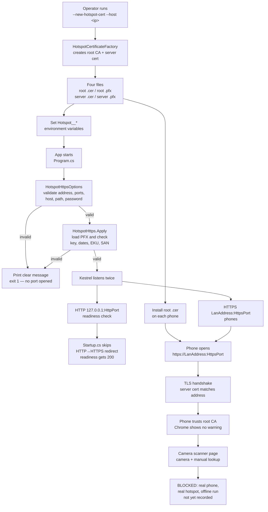

# Story 8.2 — hotspot HTTPS flow

This diagram shows only what the branch actually does. The last step — a real phone scanning a
pass — is the human acceptance step and is still `BLOCKED`.

## Mermaid



## ASCII fallback

```text
  OPERATOR (one time)
  ┌──────────────────────────────────────────────────────────────┐
  │ --new-hotspot-cert --host 192.168.137.1 --out <dir>          │
  │        │                                                     │
  │        ▼                                                     │
  │ HotspotCertificateFactory                                    │
  │   root CA (10 years) + server cert (397 days, SAN = host)    │
  │        │                                                     │
  │        ├──► root .cer  ──► install on each phone             │
  │        ├──► root .pfx  ──► keep on laptop only               │
  │        ├──► server .cer ─► optional inspection               │
  │        └──► server .pfx ─► Kestrel loads it                  │
  └──────────────────────────────────────────────────────────────┘

  APP STARTUP (every run)
  ┌──────────────────────────────────────────────────────────────┐
  │ Program.cs                                                   │
  │   HotspotHttpsOptions.FromConfiguration                      │
  │        │                                                     │
  │        ├── invalid ──► clear message, exit 1, no port         │
  │        │                                                     │
  │        ▼ valid                                               │
  │   HotspotHttps.Apply                                         │
  │     load PFX, check key / dates / EKU / SAN                  │
  │        │                                                     │
  │        ├── invalid ──► clear message, exit 1                 │
  │        │                                                     │
  │        ▼ valid                                               │
  │   Kestrel                                                    │
  │     ├── HTTP  127.0.0.1:5080  ──► readiness check (200)      │
  │     └── HTTPS 192.168.137.1:5443 ──► phones                  │
  └──────────────────────────────────────────────────────────────┘

  PHONE (human acceptance, still BLOCKED)
  ┌──────────────────────────────────────────────────────────────┐
  │ open https://192.168.137.1:5443                              │
  │   → TLS handshake, server cert matches the address           │
  │   → phone trusts the installed root CA                       │
  │   → Chrome shows no certificate warning                      │
  │   → camera scanner page loads                                │
  │   → scan a pass, see name + student number                   │
  │   → repeat scan, manual lookup, camera-denied fallback       │
  │   → repeat offline and on a second phone                     │
  └──────────────────────────────────────────────────────────────┘
```

## What the code does not do

- It does not generate a certificate automatically at startup. The command is a deliberate one-time
  operator action, because the root certificate has to be installed on the phones.
- It does not install the root certificate on a phone. That is a manual Android/iOS step.
- It does not prove the phone scan. The evidence file stays `BLOCKED` until a real run is recorded.
