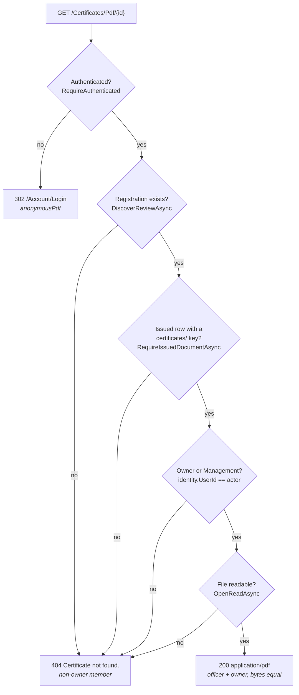
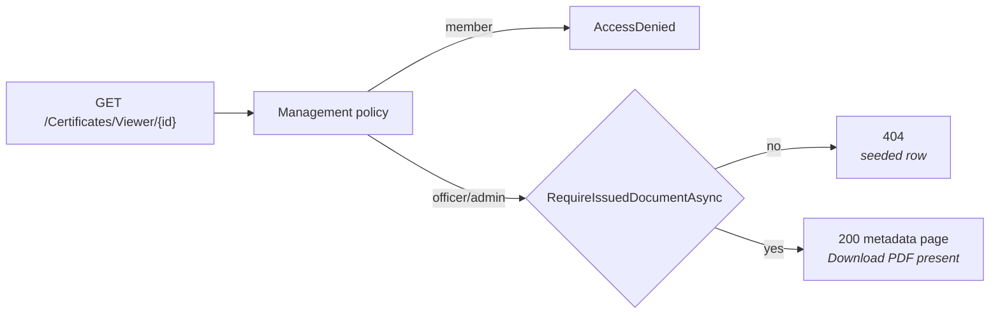

# Block 5 — what the tests actually pin

Two entry points, two gate chains. The test names on the arrows are the assertions that reach that gate.

## PDF route

The seeded row and the tampered key both land on the same `ROW` refusal: one has a blank `file_path`, the other a `uploads/venues/` key. The tampered-key test writes a real PNG into the venue area first, so removing the prefix clause turns it into a 200 and the assertion goes red.

## Viewer route

The viewer shares the gate but not the ownership check — it never reaches `OWN`, because Management is the only audience.

## What stays green if it breaks

| Behaviour | Would stay green because |
|---|---|
| `Forbidden` vs `NotFound` inside the service | the `[Authorize]` filter answers first; no test calls the service directly |
| The viewer's ownership exemption | only Management can reach it, so the absent check is unobservable |
| Switch-off end-to-end | the DI test asserts registration only; no host runs with the switch off |
| Concurrent downloads | no test issues two reads at once; the path is read-only |
| `download=false` disposition | asserted only through the 200 body, never that it is *not* an attachment |
