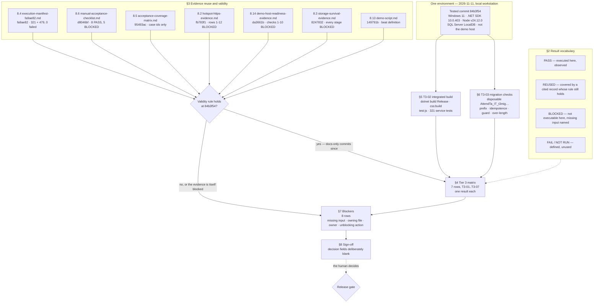

# How the record is built — PR #225

One tested commit, two executed rows, and a validity verdict for every source it
does not re-run. Nothing in the document is a second run: the matrix is a
projection of the reuse decisions plus the two observations, and the blockers are
the projection of every decision that came out negative.

## What the diagram exposes

| Observation | Where it shows | Status |
|---|---|---|
| Every row traces to either an executed observation or a named source | T3-02/T3-03 feed the matrix; §3 feeds it too | Sound |
| A source that fails its validity rule becomes BLOCKED, never PASS | the `V` decision node | Sound |
| Two rows use a result word the legend does not define | `PASS (none required)`, `BLANK` | Defect (Tier 2) |
| The matrix has no edge for the 8.7 journey | §3 has no 8.7 source at all | Defect (Tier 1) |
| The sign-off block is the only path to the gate | §8 | Sound — and deliberately empty |

The missing edge is the review's headline. PR #226 merged
[demo-walkthrough-evidence.md](../demo-walkthrough-evidence.md) onto `dev`
after this record was written, and it was executed on the **same tested commit,
`84b3f54`**. Under the rule the `V` node applies, that source is valid, so T3-04
belongs on the `yes` branch. It sits on the `no` branch because the source did
not exist in the tree on the day the record was written.
