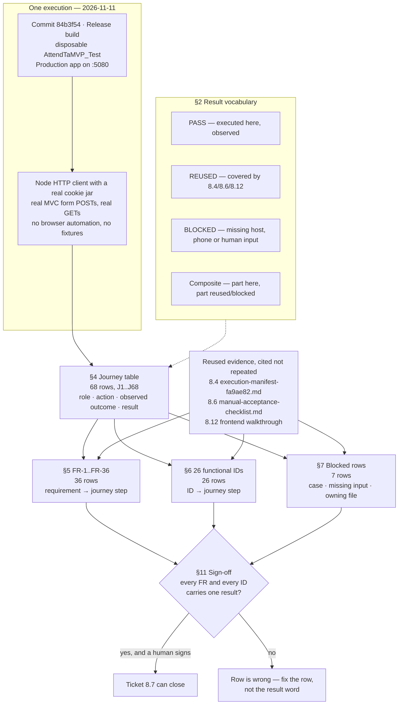

# How the record is built — PR #226

One execution, one journey table, and three projections of it. Nothing in the
document is a second run; every table after the journey is a re-index of the same
evidence.

## What the checks proved

`check-record.ps1` in this folder re-derives the structural claims instead of
trusting them:

| Claim | Check | Result |
|---|---|---|
| 68 journey rows, contiguous | J1..J68 present, no gap, no duplicate | PASS |
| Index tables only cite real rows | 51 distinct J-references, all resolve | PASS |
| FR-1..FR-36 exactly once | 36 rows, no missing, no duplicate | PASS |
| Every FR row has a result | no short row | PASS |
| 26 functional IDs exactly once | all 26 expected, no extra | PASS |
| 7 blocked rows, each naming an owner | 7 rows, each cites a file | PASS |
| Plan and record agree on the blocked count | plan says 6 in one place, 7 in another | **FAIL** |

The one failure is the plan's own prose, not the record: its Implementation Notes
say "6 blocked rows" while its Auto Run Result says "7", and the record has 7.
