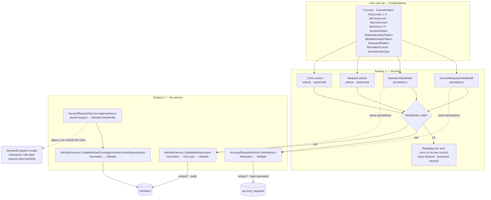

# Block 2 — how the one rule set reaches both surfaces

Mermaid source. Renders in the VS Code markdown preview, on GitHub, and in any Mermaid viewer.
Everything drawn here is taken from the files linked in the walkthrough narrative.

## Reading it

- **Left of the form:** both view models point at the same constants, so a rule cannot be changed
  in one form and not the other.
- **The diamond:** MVC applies the annotations to the raw post. A failure redisplays with the error
  on its own control; the input is kept and the password is not echoed back.
- **The dotted lines:** the services do not own a second rule set. They run
  `Validator.TryValidateObject` over the same annotated view models, which is why a direct service
  call is refused by the same rules as a crafted POST.
- **The bottom right:** approval builds a `MemberViewModel` from the *stored* request, so a pending
  request written before the rules existed fails validation and rolls back. That is the one path
  with no in-app correction; `database/inventory-legacy-profile-values.sql` lists those rows.
