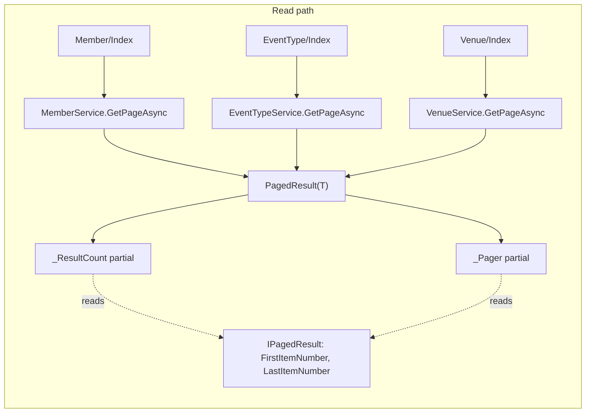
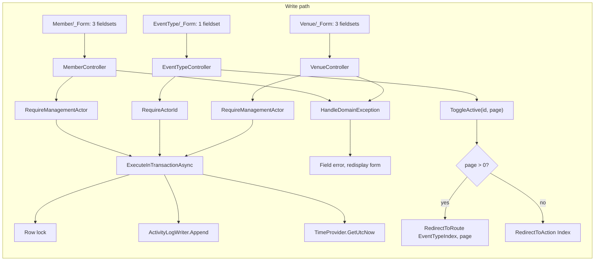

# Block 2 — Broad strokes: the mechanism

Three layers, one shape. The lists all produce `PagedResult(T)` and hand it to the same two partials; the editors all render a `_Form` partial and return through the same error handler; the services all resolve the actor, open a transaction, take a row lock, and append an audit entry.

## Read path — lists

The empty branch keeps the same `<table>` and puts the message in a `colspan` row, so the headers survive.

## Write path — editors, services, toggle

## Why it holds together

- `IPagedResult` is the seam: the pager and the result count both read the same object, so a list cannot show a count that disagrees with its pager.
- `_Form` is the seam for editors: required markers and fieldset grouping are defined once per module and inherited by both Create and Edit.
- `HandleDomainException` is the seam for failures: a field error redisplays the form, a field-less failure redirects with a toast.
- The named `EventTypeIndex` route is what makes the toggle return to `/EventType?page=N` rather than `/EventType/Index?page=N`.
